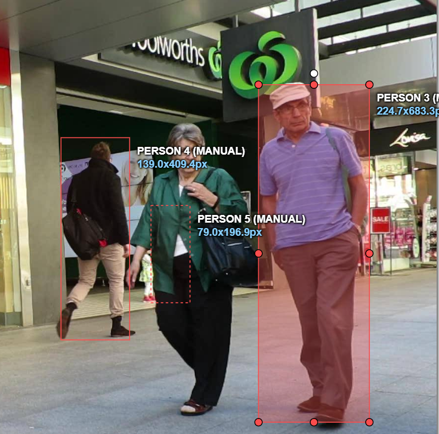
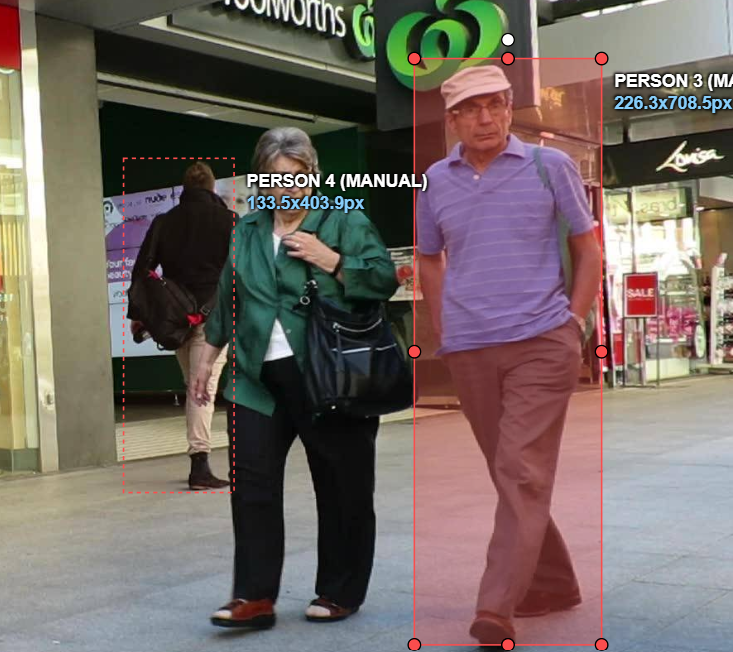
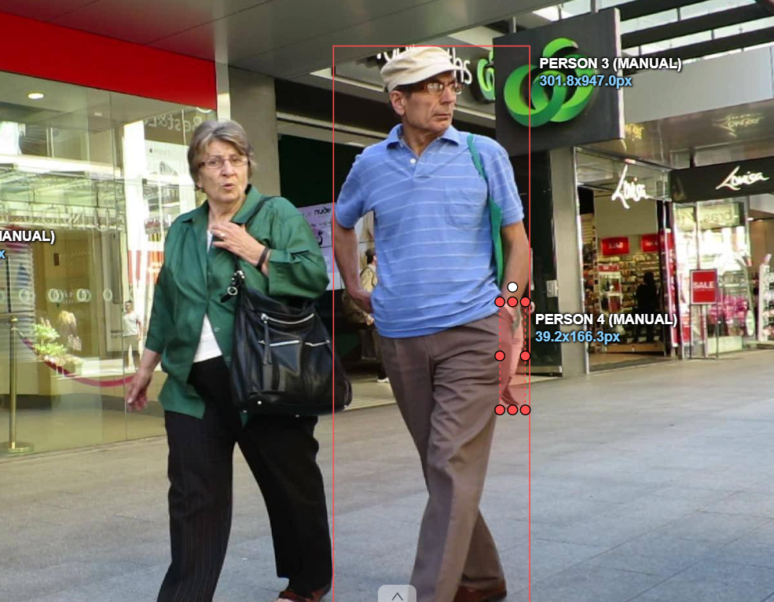

# Báo cáo cá nhân — DaoDuyHieu-2A202603235

Đoạn video: MOT17-09, 150 frame (frame 1–150), nguồn MOTChallenge, giấy phép CC BY-NC-SA 3.0.

## 0. Thông tin học viên

- Họ tên: Đào Duy Hiếu
- MSSV: 2A202603235
- Mã đề (A/B/C): C
- Email: 26ai.hieudd2@vinuni.edu.vn
- Link repository: https://github.com/HIEU2460/K5-L2-DAY05-DaoDuyHieu-2A202603235-MOTTracking.git
- Giờ bắt đầu: 16:00
- Giờ kết thúc: 19:30

## 1. Xem trước đoạn video (CP0)

Ghi **trước khi vẽ**, mỗi người một dòng.

| Mã | Frame xuất hiện | Frame cuối thấy được | Rẽ / dừng / đổi tốc độ ở frame | Bị che ở frame | Ghi chú |
|---|---|---|---|---|---|
| P1 | 0 | 149 | Di chuyển chậm trong cửa hàng | 0–59 (`occluded`) | Người ở phía trong cửa hàng Vodafone; tương ứng PERSON 1 / Track 0 |
| P2 | 61 | 149 | Xuất hiện từ frame 61; có nhiều lần chỉnh box dày ở đoạn 100–142 | 61–99, 101 và 131 (`occluded`) | Người xuất hiện tại khu vực cửa kính bên trái; tương ứng PERSON 2 / Track 1 |
| P3 | 0 | 149 | Di chuyển từ phía phải và thay đổi kích thước khi tiến gần camera; không thấy mốc dừng rõ | 0–69 (`occluded`) | Người đàn ông mặc áo xanh, đội mũ; tương ứng PERSON 3 / Track 2 |
| P4 | 0 | 109 | Di chuyển ở phía xa và ra khỏi đoạn theo dõi sau frame 109 | 90–109 (`occluded`), từ 110 (`outside`) | Người phụ nữ ở phía xa, gần khu Woolworths; tương ứng PERSON 5 / Track 4 |
| P5 | 0 | 149 | Di chuyển từ trái sang phải; thay đổi rõ quanh frame 109–127 và khi xuất hiện lại ở 149 | 0–39, 109, 113–119, 127–136 và 149 (`occluded`); 120–126, 137–148 (`outside`) | Người đàn ông mặc áo khoác đen; tương ứng PERSON 4 / Track 3 |

## 2. Keyframe và thời gian (CP1, CP4)

Số keyframe lấy từ kết quả `src/check_submission.py`.

| Mã | Số keyframe | Keyframe ở frame | Số frame có mặt | Keyframe / 100 frame | Thời gian (phút) | Chỗ khó |
|---|---|---|---|---|---|---|
| P1 | 16 | 0, 10, 20, 30, 40, 50, 60, 70, 80, 90, 100, 110, 120, 130, 140, 149 | 150 | 10.7 | Không ghi riêng | Không có |
| P2 | 20 | 61, 71, 81, 91, 100, 101, 102, 110, 111, 112, 120, 121, 122, 130, 131, 132, 140, 141, 142, 149 | 89 | 22.5 | Không ghi riêng | Không có |
| P3 | 16 | 0, 10, 20, 30, 40, 50, 60, 70, 80, 90, 100, 110, 120, 130, 140, 149 | 150 | 10.7 | Không ghi riêng | Không có |
| P4 | 10 | 0, 10, 20, 30, 40, 50, 60, 80, 90, 100 | 110 | 9.1 | | Không có |
| P5 | 19 | 0, 10, 20, 30, 40, 50, 60, 70, 80, 90, 100, 109, 110, 113, 114, 117, 119, 127, 149 | 131 | 14.5 | Không ghi riêng | Không có |
| **Tổng** | **81** | — | **630** | **12.9** | | |

Keyframe / 100 frame của cả bài = tổng keyframe ÷ tổng số frame có mặt × 100 = 81 ÷ 630 × 100 = **12.9**.
Bạn đặt keyframe nhiều nhất ở người nào? Vì sao (người đó rẽ, dừng, lại gần camera hay bị che)?
Trả lời: P2 có nhiều keyframe nhất, với 20 keyframe trên 89 frame có mặt. Người này xuất hiện muộn, bị che trong nhiều frame và cần chỉnh box liên tục, đặc biệt ở đoạn frame 100–142, để box không bị trôi khi CVAT nội suy.

## 3. Đoạn bị che (CP2)

Người bị che: `P5`

| Mốc | Frame |
|---|---:|
| Bắt đầu bị che một phần (bật `occluded`) | 110 |
| Mất hẳn (bật `outside`) | 122–127 |
| Hiện lại (tắt `outside`) | 128 |
| Thấy rõ trở lại (tắt `occluded`) | Chưa thấy rõ hoàn toàn trong đoạn theo dõi |

- Thời gian khuất hẳn: 6 frame = 0.2 giây (6 ÷ 30 fps).
- Quyết định: giữ cùng ID.
- Lý do (trả lời 3 câu: khuất bao lâu so với 60 frame, ngoại hình có khớp, chỗ hiện lại có đúng hướng và tốc độ):

P5 chỉ khuất hẳn 6 frame, ngắn hơn ngưỡng 60 frame của lớp. Khi xuất hiện lại, người này vẫn có ngoại hình khớp với trước khi bị che (áo khoác đen, quần màu be và túi đeo) và xuất hiện ở vị trí phù hợp với hướng di chuyển trước đó. Vì vậy, P5 được giữ cùng track và cùng ID thay vì tạo track mới.

Ảnh chụp màn hình:

## 4. Tự review ID (CP3)

Lượt 1 theo người (đi ngược từ frame 149 về 0 trên CVAT), lượt 2 theo cảnh (nhảy 10 frame). Ít nhất 3 dòng; không có lỗi thì ghi một dòng "đã kiểm hai lượt, không lỗi".

Loại lỗi dùng đúng một trong 7 mã: `id_switch`, `fragmentation`, `lost`, `merge`, `false_track`, `drift`, `flag`.

| Frame | Mã người | Loại lỗi | Mô tả một câu | Phát hiện ở lượt | Đã sửa? |
|---:|---|---|---|---|---|
| 35 | P5 | drift | box nội suy bị trôi lệch khỏi người cánh tay của người nằm ngoài box | 1 | Đã sửa |
| 70 | P5 | flag | bật/tắt sai occluded khi người không bị che, khuất | 2 | Đã sửa |
| Không phát hiện | không phát hiện | Không phát hiện | Không phát hiện | Không phát hiện | Không phát hiện |

Tổng hợp số lỗi theo loại:

| `id_switch` | `fragmentation` | `lost` | `merge` | `false_track` | `drift` | `flag` |
|---:|---:|---:|---:|---:|---:|---:|
| 0 | 0 | 0 | 0 | 0 | 1 | 1 |

Lỗi nào chỉ lượt 2 (theo cảnh) mới thấy, lượt 1 (theo người) không thấy? Vì sao?
Trả lời: lượt 1 tập trung theo dõi vị trí và độ bám của box của từng người, lượt 2 nhìn toàn cảnh nên dễ nhận ra P5 không bị che nhưng vẫn bật occluded.

## 5. File xuất và kết quả tự kiểm (CP4)

| Kiểm tra | Kết quả |
|---|---|
| Tên file MOT 1.1 | `DaoDuyHieu_mot.zip` |
| Tên file CVAT for video 1.1 | `DaoDuyHieu_cvat_video.zip` |
| Số track ID khác nhau trong `gt/gt.txt` (phải là 5) | 5 |
| Frame `outside` không có dòng trong `gt.txt` (đúng / sai) | Đúng |
| Job đã completed trên CVAT máy cá nhân | Đã complete |

Dán phần tóm tắt in ra từ `src/check_submission.py`:

=== File MOT 1.1: DaoDuyHieu_mot.zip ===
  Số track ID: 5   |   Tổng số box: 630
  [OK]        Đúng 5 track ID.

  Track | Frame có mặt | Số frame | Đoạn vắng (outside)
      1 |   0–149      |      150 | -
      2 |   0–149      |      150 | -
      3 |   0–149      |      131 | 120–126, 137–148
      4 |   0–109      |      110 | -
      5 |  61–149      |       89 | -

=== File CVAT for video 1.1: DaoDuyHieu_cvat_video.zip ===

  Track | Nhãn   | Frame thấy | Keyframe | KF/100 frame | Frame occluded | Lần bật outside
      0 | person |        150 |       16 |         10.7 |             60 |               0
              Track 0: keyframe ở frame [0, 10, 20, 30, 40, 50, 60, 70, 80, 90, 100, 110, 120, 130, 140, 149]
      1 | person |         89 |       20 |         22.5 |             41 |               0
              Track 1: keyframe ở frame [61, 71, 81, 91, 100, 101, 102, 110, 111, 112, 120, 121, 122, 130, 131, 132, 140, 141, 142, 149]
      2 | person |        150 |       16 |         10.7 |             70 |               0
              Track 2: keyframe ở frame [0, 10, 20, 30, 40, 50, 60, 70, 80, 90, 100, 110, 120, 130, 140, 149]
      3 | person |        131 |       19 |         14.5 |             59 |               2
              Track 3: keyframe ở frame [0, 10, 20, 30, 40, 50, 60, 70, 80, 90, 100, 109, 110, 113, 114, 117, 119, 127, 149]
      4 | person |        110 |       10 |          9.1 |             20 |               1
              Track 4: keyframe ở frame [0, 10, 20, 30, 40, 50, 60, 80, 90, 100]

  Tổng: 81 keyframe / 630 frame có mặt = 12.9 keyframe / 100 frame
  [OK]        Đọc được 5 track từ annotations.xml.

=== Tóm tắt ===
  Lỗi: 0   |   Cảnh báo: 0
  Đạt. Dán phần tóm tắt này vào báo cáo mục 5.

## 6. Ba câu kết

1. Nếu được gán lại, bạn sẽ đặt keyframe khác ở đâu? Vì sao?
Trả lời: Nếu được gán lại, tôi sẽ đặt thêm keyframe cho P2 trong đoạn frame 100–142 và cho P5 ngay trước và sau đoạn bị che. Đây là những đoạn box dễ bị trôi do người thay đổi vị trí, kích thước hoặc bị che, khiến nội suy tuyến tính của CVAT không còn chính xác.

2. Có chỗ nào bạn không chắc "cùng ID hay ID mới"? Bạn đã quyết định và ghi chú thế nào?
Trả lời: Tôi từng không chắc nên giữ cùng ID hay tạo ID mới cho P5 trong đoạn frame 122–127. P5 chỉ khuất hoàn toàn 6 frame, ít hơn ngưỡng 60 frame; ngoại hình và hướng di chuyển khi xuất hiện lại vẫn khớp, nên tôi quyết định giữ cùng track ID.

3. Một lỗi ID trong job của bạn (nếu không còn sót, chọn lỗi đã sửa) có thể làm xe tự lái dự đoán sai chuyển động của người đó như thế nào? Lỗi đó ảnh hưởng MOTA hay IDF1 nhiều hơn?
Trả lời: Lỗi drift của P5 tại frame 35 có thể khiến hệ thống dự đoán sai vị trí và chuyển động của người đi bộ. Lỗi này ảnh hưởng MOTA nhiều hơn vì box lệch có thể tạo FN hoặc FP.

## 7. Tài liệu tham khảo và công cụ AI đã dùng

- Tài liệu trong repository: `CHECKPOINTS.md`, `docs/GUIDELINE.md`, `docs/CVAT_LOCAL_SETUP.md`, `docs/CVAT_CHEATSHEET.md` và `docs/MOT_FORMAT.md`.
- Có sử dụng trợ lý AI để giải thích yêu cầu bài lab, hướng dẫn thao tác CVAT, cách export và cách chạy `src/check_submission.py`; không sử dụng AI để sinh box hoặc track ID.
